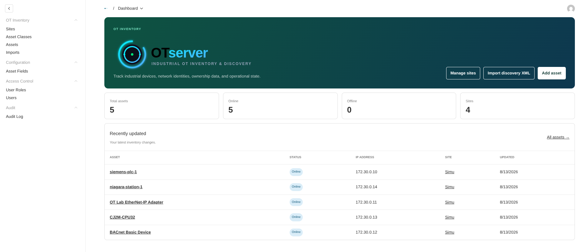

<div align="center">

# OTserver

### Self-hosted OT inventory with automatic discovery found here [OTserver Otter repository](https://github.com/ruveydac/otserver-otter)

Native OT discovery · Quality-aware inventory · Site-scoped access · Immutable history

[](https://otserver.org)
[](https://nextjs.org/)
[](https://www.mongodb.com/)
[](https://github.com/ruveydac/otserver-otter)
[](LICENCE.md)

[Quick start](#quick-start) · [How it works](#how-it-works) · [Imports](#discovery-and-imports) · [Otter](#otserver-otter) · [Development](#development)

</div>

---

OTserver provides a trustworthy industrial inventory. Automatic discovery lives in the separate
**[OTserver Otter](https://github.com/ruveydac/otserver-otter)** repository: a cross-platform Rust CLI
built specifically for identifying industrial devices through fixed, read-only protocol requests.
It collects structured evidence—not just a flat host list—and exports observations, interfaces,
ports, and topology through a strict versioned contract understood directly by the manager.

OTserver turns that evidence into a site-scoped inventory with provenance-aware
field merging, flexible hierarchies, role-based access, search, and a complete audit trail.



## What you get

- **OTserver Otter** — Discover devices on Windows and Linux using native ARP, PROFINET
  DCP, S7, EtherNet/IP, BACnet, Omron FINS, Niagara Fox, DNP3, IEC 61850, OPC UA, SNMP, and LLDP
  requests.
- **Rich discovery evidence** — Preserve per-protocol observations, field quality, interfaces,
  ports, topology links, warnings, and partial failures in a validated JSON contract.
- **OT inventory** — Automatically track vendor, model, firmware, protocols, ownership, location,
  status, criticality, and custom fields.
- **Flexible site hierarchy** — Model regions, plants, areas, lines, cells, or any structure your
  organization uses.
- **Scoped access** — Grant read-only or read/write access to a site and all its descendants. A
  protected Admin role retains unrestricted access.
- **Discovery imports** — Ingest Siemens PRONETA XML, Nmap XML, and OTserver Otter JSON into a
  selected site.
- **Otter management** — Enroll site-bound scanners, configure encrypted scan profiles, schedule
  jobs, and inspect run history from the management interface.
- **Physical device identity** — Correlate qualified hardware identities across multiple network
  interfaces; retain site-scoped MAC bindings, module installations, and replacement history.
- **Evidence-aware merging** — Higher-quality discoveries can improve lower-quality data while
  human edits remain authoritative. Protocol evidence is combined across sources.
- **Search and filters** — Use the graphical filter builder or a supported Lucene query syntax for
  precise inventory searches.
- **Traceable history** — Retain source observations and topology links alongside an immutable,
  secret-redacting audit log.
- **Passive vulnerability lookup** — Match recorded vendor, product, and version data against local
  CISA KEV and NVD catalogs without probing the device.

## Quick start

### Docker deployment (GitHub Container Registry)

Deploy the prebuilt image from GitHub Container Registry:
`ghcr.io/ruveydac/otserver:latest`. Release images also have version tags (`X.Y.Z` and
`X.Y`); use an exact version tag for a pinned deployment.

With Docker Engine and Compose installed, create a deployment directory containing this
`compose.yaml`:

```yaml
services:
  otserver:
    image: ghcr.io/ruveydac/otserver:latest
    restart: unless-stopped
    ports:
      - '3000:3000'
    environment:
      DATABASE_URL: mongodb://mongo:27017/otserver?replicaSet=rs0
      OTSERVER_SECRET: ${OTSERVER_SECRET:?Set OTSERVER_SECRET in .env}
      OTSERVER_PUBLIC_URL: ${OTSERVER_PUBLIC_URL:-}
      OTSERVER_OTTER_ENCRYPTION_KEY: ${OTSERVER_OTTER_ENCRYPTION_KEY:-}
      OTSERVER_QUEUED_IMPORTS: ${OTSERVER_QUEUED_IMPORTS:-off}
      OTSERVER_VULNERABILITY_FEEDS: ${OTSERVER_VULNERABILITY_FEEDS:-on}
      OTSERVER_WORKER_MODE: ${OTSERVER_WORKER_MODE:-standalone}
      NODE_OPTIONS: ${NODE_OPTIONS:---max-old-space-size=2048}
    volumes:
      - import-files:/app/import-files
    depends_on:
      mongo:
        condition: service_healthy

  import-worker:
    profiles: [workers]
    image: ghcr.io/ruveydac/otserver:latest
    restart: unless-stopped
    command: ['node_modules/.bin/tsx', 'src/worker.ts', 'imports']
    environment:
      DATABASE_URL: mongodb://mongo:27017/otserver?replicaSet=rs0
      OTSERVER_SECRET: ${OTSERVER_SECRET:?Set OTSERVER_SECRET in .env}
      OTSERVER_WORKER_MODE: external
      NODE_OPTIONS: ${NODE_OPTIONS:---max-old-space-size=2048}
    volumes:
      - import-files:/app/import-files:ro
    depends_on:
      otserver:
        condition: service_healthy

  maintenance-worker:
    profiles: [workers]
    image: ghcr.io/ruveydac/otserver:latest
    restart: unless-stopped
    command: ['node_modules/.bin/tsx', 'src/worker.ts', 'maintenance']
    environment:
      DATABASE_URL: mongodb://mongo:27017/otserver?replicaSet=rs0
      OTSERVER_SECRET: ${OTSERVER_SECRET:?Set OTSERVER_SECRET in .env}
      OTSERVER_VULNERABILITY_FEEDS: ${OTSERVER_VULNERABILITY_FEEDS:-on}
      OTSERVER_WORKER_MODE: external
      NODE_OPTIONS: ${NODE_OPTIONS:---max-old-space-size=2048}
    volumes:
      - import-files:/app/import-files
    depends_on:
      otserver:
        condition: service_healthy

  mongo:
    image: mongo:8
    restart: unless-stopped
    command: ['--replSet', 'rs0', '--bind_ip_all']
    healthcheck:
      test:
        [
          'CMD',
          'mongosh',
          '--quiet',
          '--eval',
          'try { if (!rs.status().ok) quit(1) } catch (e) { rs.initiate({_id:"rs0",members:[{_id:0,host:"mongo:27017"}]}); quit(1) }',
        ]
      interval: 5s
      timeout: 5s
      retries: 30
    volumes:
      - data:/data/db

volumes:
  data:
  import-files:
```

Create a `.env` file beside it with a long random secret, and keep that secret across restarts:

```dotenv
OTSERVER_SECRET=replace-with-a-long-random-secret
# Required for managed Otter jobs and encrypted SNMP/OPC UA profile credentials.
OTSERVER_PUBLIC_URL=https://otserver.example
# Generate with: openssl rand -hex 32. Keep this key stable and backed up.
OTSERVER_OTTER_ENCRYPTION_KEY=replace-with-64-hex-characters
```

Pull the images and start the application and MongoDB:

```bash
docker compose pull
docker compose up -d
```

Open <http://localhost:3000/admin> and create the first administrator account.
The named volumes persist database data and uploaded import files.

The default standalone process serves the application and runs both fenced worker queues. For a
larger installation, move the queues into dedicated containers by setting these values in `.env`:

```dotenv
OTSERVER_WORKER_MODE=external
OTSERVER_QUEUED_IMPORTS=on
```

Then start the optional worker profile:

```bash
docker compose --profile workers up -d
```

Confirm both worker heartbeats in the administrator operations endpoint. Do not enable external
mode without running both worker services.

For an upgrade from MAC-only inventory, follow the [identity migration](docs/device-identity.md#upgrade-from-mac-only-inventory)
with workers stopped and before accepting new imports. It requires a replica set and removal of the
legacy unique MAC index.
For database upgrades, worker operation, backup, and restore, follow the [operations guide](docs/operations.md).

### Kubernetes memory and Node heap

The production image defaults to `NODE_OPTIONS=--max-old-space-size=2048` (MiB).
Override this environment variable on each web or worker container to fit its memory budget.
The pnpm commands preserve `NODE_OPTIONS` too. Set it before Node starts; loading it later from
the application's `.env` cannot resize an already-running heap.

A starting configuration for a container with a 4 GiB memory limit:

```yaml
env:
  - name: NODE_OPTIONS
    value: '--max-old-space-size=2048'
resources:
  requests:
    memory: 1Gi
  limits:
    memory: 4Gi
```

V8 heap is only part of process memory. Leave room for upload buffers, native allocations, and
the application runtime; do not set the heap equal to the container limit. A V8
`JavaScript heap out of memory` error and Kubernetes `OOMKilled` are different failures.
Changing resource limits alone does not override an explicit Node heap setting. Roll out new pods
after changing either setting, and remove conflicting `--max-old-space-size` command arguments.

NVD processing uses a temporary on-disk file, up to 2 GiB for one decompressed annual feed, under
`TMPDIR` (default `/tmp`). Give the maintenance process writable disk-backed temporary storage,
including when using a read-only root filesystem. Avoid a memory-backed `emptyDir` for this path:
it charges the staged feed to the pod's memory budget. Allow at least 3 GiB of free temporary disk
space and enough ephemeral-storage capacity for the image, logs, and this file. Staging is removed
on success or a handled failure; after a forced process kill, remove abandoned `otserver-nvd-*`
directories only while the maintenance process is stopped. External maintenance workers also
need the shared `import-files` volume for offline selections and staging cleanup.

To inspect the environment and default heap for a fresh Node process in the container:

```bash
kubectl exec <pod> -c <container> -- node -e 'console.log({NODE_OPTIONS:process.env.NODE_OPTIONS,heapLimitMiB:require("node:v8").getHeapStatistics().heap_size_limit/1024/1024,constrainedMemoryMiB:process.constrainedMemory()/1024/1024})'
```

This diagnostic inherits the container environment; explicit arguments on the application command
can still give that process a different limit.

### Local development

Requirements: Node.js 22, pnpm 10, and a MongoDB 8 replica set.

```bash
cp .env.example .env
# Set DATABASE_URL and replace OTSERVER_SECRET with a long random value.
pnpm install
pnpm dev
```

Then open <http://localhost:3000/admin>. The first account receives the protected Admin role.

For local Otter management, set `OTSERVER_PUBLIC_URL=http://localhost:3000` in `.env` and restart
OTserver. HTTP works on `localhost`, `127.0.0.1`, and `[::1]`, including production-mode builds;
Otter must run on the same host when using these loopback URLs. Remote controllers require HTTPS.

The repository's `docker-compose.yml` is the production-style standalone deployment. Run
`docker compose up -d mongo` when only a local development database is needed, or
`docker compose up -d --build` to test the complete containerized application.

## First inventory

1. Create your hierarchy under **Sites**. Use any site types and nesting depth that fit the plant.
2. Add assets manually, or open **Imports → Create New** and select a discovery source.
3. Review created, updated, skipped, and unresolved records on the completed import.
4. Search the inventory or open an asset to inspect its details, observations, topology, and history.

## How it works

Every asset and import belongs to a site. Assets represent physical hardware; site-scoped network
endpoints store their interfaces and addresses. Qualified manufacturer/component serial identities
can correlate multiple interfaces to one device. Ambiguous identities create review cases, and
cross-site matches require explicit reconciliation. MAC-free chassis/modules can be inventoried.

Moving assets to **Trash** keeps their hardware identities reserved for restoration. Permanently
deleting an asset releases its serial identifiers, network endpoints, and service bindings; deleting
an import alone does not. Imports automatically clear leftover bindings from older permanent
deletions, while preserving observations and audit history. To retry a previously applied upload
after cleanup, delete that import record and upload the file again; otherwise exact-file replay
protection skips processing it.

See [device identity and migration](docs/device-identity.md) for the model, supported evidence,
operator actions, transaction requirements, and compatibility behavior. Scanner changes are tracked
in the [future Otter identity roadmap](docs/otter-identity-roadmap.md).

Field values are merged in this order:

```text
human > high > medium > low
```

Empty values can always be filled. Equal-quality evidence may replace changed values, stronger
evidence may replace weaker values, and weaker evidence cannot overwrite stronger data. Manual edits
are recorded as human provenance and survive future imports.

### Vulnerability lookup

OTserver downloads the CISA Known Exploited Vulnerabilities catalog, NVD JSON 2.0 feeds, the
CERT@VDE CSAF 2.0 aggregator, CISA's OT and IT CSAF ROLIE feeds, and the ICS Advisory Project master
CSV through the background maintenance worker. Automatic updates remain on a seven-day schedule.
Administrators can also open **Vulnerabilities > Vulnerability Feeds** and press **Update feeds now**
to check immediately. Unchanged NVD years are skipped using their published checksums. The page
shows queued/running work and each source's results; closing the browser does not stop the worker.

For an isolated installation, set `OTSERVER_VULNERABILITY_FEEDS=off` in both the application and any
external maintenance worker. This disables automatic and button-triggered internet downloads while
keeping **Upload downloaded feeds** available. Uploaded files are processed without network access.

The first import processes NVD's annual files from 2002 onward. Both online and offline NVD imports
stream decompression and checksum verification, validate the complete JSON before writing, and
upsert at most 100 records per batch. Large batches also flush at roughly 4 MiB of serialized data.
The annual file stays on temporary disk rather than in JavaScript heap. Offline jobs preflight all
selected years before any catalog writes. Each completed year is recorded, so a retry skips unchanged
years. Asset matching reads candidates in pages of 100 rather than loading thousands at once.

#### Transfer original feeds into an isolated installation

1. Open **Vulnerabilities > Vulnerability Feeds > Upload downloaded feeds** and choose a source.
2. Save the download instructions, take them to an internet-connected computer, and download the
   original publisher files. Keep their original filenames.
3. Transfer the files to the isolated computer and select **Choose files** or **Choose folder**.
   Files upload individually, with progress. Keep the selection ID to resume a staged upload.
4. Use **Check uploaded files** to review coverage, publisher dates, and any missing-file links.
5. Press **Import uploaded … files**. The maintenance worker verifies file digests, NVD checksums,
   and every selected file's contents before changing the catalog. Results appear on the feed page.

| Source               | Original files to transfer                                                                                                                        |
| -------------------- | ------------------------------------------------------------------------------------------------------------------------------------------------- |
| CISA KEV             | `known_exploited_vulnerabilities.json`                                                                                                            |
| NVD                  | Each selected `nvdcve-2.0-YYYY.json.gz` (or `.json`) and matching `.meta` file                                                                    |
| ICS Advisory Project | `CISA_ICS_ADV_Master.csv`                                                                                                                         |
| CSAF                 | The CERT@VDE aggregator, every referenced provider metadata/index/advisory file, and both CISA OT/IT indexes with all their referenced advisories |

NVD years can be imported in batches; unselected years and other sources remain intact. The feed
shows **partial** until all annual years have been loaded. NVD's `.meta` checksum covers the
**uncompressed JSON**, including when the transferred file is `.json.gz`.

For CSAF, start with the aggregator and the two CISA indexes shown in the guide. Checking those
files discovers further provider metadata, indexes, and advisory URLs. Save the missing-file links,
download them on the connected computer, transfer them, and check again until the snapshot is
complete. When filenames repeat, preserve `hostname/path/to/file.json` directories inside the
selected folder, or use **Upload this file** beside the specific missing URL. Offline processing
never follows those links over the network. An incomplete or malformed snapshot leaves the previous
CSAF catalog in place.

Each upload is limited to 500 MiB, each selection to 8 GiB, and decompressed feeds to 2 GiB. Use NVD's
compressed files for large years. Staged files expire after seven days and are removed by maintenance;
files needed by queued/running imports are retained. With external workers, the application and worker
must share the existing `import-files` volume. Successful imports recalculate asset vulnerability counts
and record the initiating administrator in the audit trail.

Assets store only a derived vulnerability count. A CVE is counted only when its NVD or CSAF vendor
and product match the recorded asset data and the asset reports a version satisfying the affected
exact version or range. CISA KEV enriches matching records with known-exploitation information and
the ICS Advisory Project adds CISA ICS advisory identifiers, critical-infrastructure sectors,
product distribution, and vendor headquarters; neither can create a count on its own because neither
carries affected-version constraints.

The asset detail view lists the five most severe matches — known-exploited first, then highest CVSS —
and links to a paginated subview holding every match plus its evidence. Results are unvalidated
metadata matches, not evidence that the device is vulnerable. OTserver does not run active
vulnerability checks.

For a GUI smoke test, upload `tests/otserver_otter_files/OTserver-Otter-known-vulnerability.json`
under **Imports** as an OTserver Otter file. It creates a demo Siemens S7-1500 CPU with firmware
`V2.8.0`, which matches NVD `CVE-2020-15782` while the catalog is loaded.

## Discovery and imports

| Source          | Input                   | Default quality      | Best for                                                     |
| --------------- | ----------------------- | -------------------- | ------------------------------------------------------------ |
| OTserver Otter  | Schema-version-2 JSON   | Observation-specific | Native discovery with observations, interfaces, and topology |
| Siemens PRONETA | Topology XML            | High                 | Siemens-oriented discovery and topology exports              |
| Nmap            | XML produced with `-oX` | Medium               | Existing Nmap-based discovery workflows                      |

Import files are treated as untrusted input: parsers enforce size and structure limits, tolerate
optional vendor data, and report malformed or uncorrelatable observations as warnings. The canonical
wire contract is pinned through the `otserver-otter` submodule at
[`otserver-otter/contracts/otserver-scan-v2.schema.json`](otserver-otter/contracts/otserver-scan-v2.schema.json).
The Assets CSV is a schema-dependent diagnostic export; its columns follow the stored asset fields and
may change as that schema evolves.

Example searches:

```text
vendor:Siemens AND status:online
protocol:profinet AND criticality:critical
site:"Plant 1" AND type:plc
lastseen:[2026-01-01 TO *]
```

## OTserver Otter

Download the scanner for your platform from the
[OTserver Otter releases page](https://github.com/ruveydac/otserver-otter/releases).

Otter is not a wrapper around a general-purpose scanning engine. Its discovery, protocol
framing, response validation, correlation, and export contract are implemented together for this
inventory workflow.

- **Native protocol identity** — Uses fixed queries designed to retrieve device identity without
  configuration changes, vulnerability scripts, or exploit behavior.
- **Evidence-preserving output** — Keeps protocol observations and raw source data alongside
  normalized devices instead of collapsing a scan into one guessed record.
- **Topology-aware collection** — Carries LLDP, SNMP, and PROFINET link evidence, network interfaces,
  and ports into OTserver.
- **Quality-aware by design** — Each observation reaches the importer with its source quality, so
  stronger evidence improves the inventory without overwriting human edits.
- **Predictable failure handling** — Produces valid partial results with warnings when individual
  probes fail, while malformed and unsolicited responses are rejected.

Otter requires `--ack-authorized` before a scan. Linux uses `AF_PACKET` raw sockets and needs
root or `CAP_NET_RAW`; Windows 10+ uses native Win32 IP Helper, a separately installed Npcap for
active PROFINET DCP, and Packet Monitor (pktmon) as a passive fallback.

```bash
otserver-otter doctor
sudo otserver-otter scan \
  --target 192.168.1.0/24 \
  --interface eth0 \
  --source-mac 00:11:22:33:44:55 \
  --output scan.otserver.json \
  --ack-authorized
```

Only scan networks you own or are authorized to assess. Otter does not perform configuration
writes, SNMP SET, DCP Set, DNP3 writes, operates, class assignment, freezes, or restarts, brute
force, exploits, vulnerability scripts, or Modbus requests.

For standalone CLI uploads, users can enable a Payload API key on their account. With an OTserver
URL, site ID, and that key in the Otter environment or executable-adjacent `otter.json`, Otter can
send completed JSON to the existing REST importer using the user's current site permissions. The
local scan file is retained. Managed scanner uploads use site-bound Otter credentials instead;
see [Otter management](otter_management.md).

### Central Otter management

OTserver provides site-scoped Payload collections for Otter registrations, scan profiles,
encrypted SNMP/OPC UA credentials, schedules, manual runs, and run history. Enrolled agents report
their computer name and network adapters; the Payload profile editor uses that inventory for interface
selection and exposes all managed scan options. Grant the **Otter Config**
capability to a role; users still need the corresponding site read/write permissions. Enrollment
tokens are single-use, and scanner credentials are restricted to that scanner's bound site.
Open **Otter → Otter Scanners** and select **Create New** for the enrollment popup. Use
**Otter → Otter Configurations** to select the scanner and site, set all scan options, configure
import overrides, and queue a scan with **Run now**. Schedules reference these same configurations.
Each run snapshots its options, credentials, and import overrides. Managed import names include
the scanner name, site, and UTC date/time. Existing scanner-level settings are no longer applied;
copy any previously used network overrides into the appropriate configuration before running it.

Use Otter's `controller --server-url URL --enroll --ack-authorized` command and paste the token
from the enrollment popup at the prompt. For same-host development, `--server-url 127.0.0.1:3000`
uses HTTP; remote controllers require HTTPS. Restart without `--enroll` to reuse the saved
credential. Setup and the management protocol are documented in [`otter_management.md`](otter_management.md). Set
`OTSERVER_PUBLIC_URL` and a stable `OTSERVER_OTTER_ENCRYPTION_KEY` before configuring managed
profiles. Apply the Otter management migration during the normal versioned upgrade procedure.

OTserver Otter, its platform guide, contract, tests, and interoperability lab are maintained in the
separate [`otserver-otter` repository](https://github.com/ruveydac/otserver-otter).

## Security and audit model

- Collection access rules enforce site permissions on the server; hiding an admin view is never the
  security boundary.
- Read and write permissions inherit through every descendant of the selected site.
- The protected Admin role is created automatically and cannot be renamed or deleted.
- All registered collections are audited for creates, updates, deletes, and authentication events.
- Audit entries are immutable and redact fields resembling passwords, secrets, tokens, hashes, or
  sessions.
- Standalone Otter SNMP and OPC UA credentials remain in executable-adjacent `otter.json`. Managed
  profile credentials are encrypted at rest. Neither form is included in logs or scan exports.

## Technology

| Layer         | Technology                                  |
| ------------- | ------------------------------------------- |
| Application   | Next.js 16, React 19, TypeScript            |
| Admin and API | OTserver, built on Payload CMS 3            |
| Database      | MongoDB                                     |
| Search        | Lucene subset translated to Payload queries |
| Otter         | Rust, native Windows and Linux capture      |
| Validation    | Vitest integration tests                    |

## Project layout

```text
src/collections/   OTserver collections, hooks, and domain rules
src/access/        Shared site-scoped authorization
src/importers/     PRONETA, Nmap, Otter parsers, and quality merging
src/search/        Lucene query translation and graphical-filter integration
src/vulnerabilities/ Feed synchronization, CPE parsing, and passive matching
src/components/    OTserver admin views, branding, and fields
src/otter/         Site-bound scanner enrollment, controller API, encrypted profiles, and schedules
otserver-otter/    Pinned scanner repository and canonical export contract
tests/int/         Application and importer integration tests
```

## Development

Run the smallest relevant check while working, then the full application suite. Test commands create
and remove their own MongoDB 8 replica set and upload directory; Docker or Podman is required:

```bash
pnpm test
pnpm lint
pnpm build
```

Verify the production container and fresh-database bootstrap with Docker or Podman:

```bash
pnpm test:container
```

Set `CONTAINER_RUNTIME=docker` or `CONTAINER_RUNTIME=podman` to select one explicitly.

Verify controller interoperability with the real Rust executable and Payload REST API (requires the
Rust toolchain and initialized Otter submodule):

```bash
pnpm test:otter-client
```

This builds the headless client and tests enrollment using bare loopback and explicit HTTP URLs,
assignment execution, schema-v2 upload/import, and restart using saved credentials.

Coverage is enforced at 90% for the application:

```bash
pnpm test:coverage
```

Regenerate OTserver's Payload artifacts after schema or admin component changes:

```bash
pnpm generate:types
pnpm generate:importmap
```

## License

OTserver and OTserver Otter are dual-licensed:

The open-source core will remain open source: the scanner, all detection
needed to find assets and device capabilities, and the base asset-management
interface features. Enterprise offerings may add optional proprietary add-ons,
such as SSO integrations or customized dashboards; they do not replace or
restrict the open-source core.

1. **Open Source (GNU AGPLv3):** available under the
   [GNU Affero General Public License v3](LICENCE.md).
2. **Commercial License:** available for enterprises, SaaS providers, or
   organizations integrating OTserver into their systems.

For a commercial license, custom SLA support, enterprise features, or help
choosing the right license, visit [otserver.org/enterprise](https://otserver.org/enterprise/).
