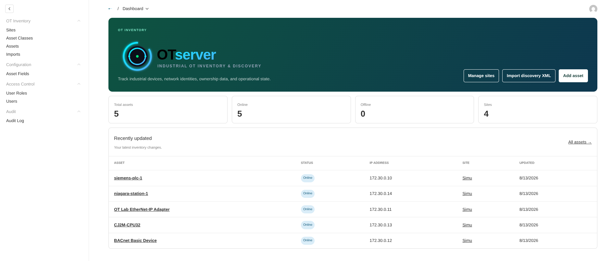

<div align="center">

# OTserver

### Self-hosted OT inventory with automatic discovery

Native OT discovery · Quality-aware inventory · Site-scoped access · Immutable history

[](https://otserver.org)
[](https://nextjs.org/)
[](https://codecov.io/gh/ruveydac/OTserver)
[](https://www.mongodb.com/)
[](https://github.com/ruveydac/otserver-otter)
[](LICENCE.md)

[Quick start](#quick-start) · [Features](#what-you-can-do) · [Otter](#discovery-with-otserver-otter) · [Development](#development-and-technical-guidance)

</div>

---

Self-hosted asset management for operational technology (OT) networks.

OTserver helps you keep track of industrial devices, where they are installed, and how they
change over time. Add assets manually or import discovery results from
[OTserver Otter](https://github.com/ruveydac/otserver-otter), Siemens PRONETA, or Nmap.



## What you can do

- Maintain an inventory of device manufacturers, models, firmware, protocols, ownership, and custom fields.
- Organize assets into sites using a hierarchy that fits your organization.
- Give teams read-only or read/write access to the sites they manage.
- Combine discovery results while preserving manual edits and the source of each value.
- Search and filter assets, inspect topology, and review an immutable change history.
- Enroll Otter scanners, configure discovery, schedule scans, and review results centrally.
- Find and review potential vulnerability matches using recorded device metadata and local catalogs.
  Confirm, dismiss, resolve, and reopen findings without probing devices; changed matching criteria
  flag confirmed findings for review.

## Quick start

With Docker Engine and Compose installed, save this as `compose.yaml`:

```yaml
services:
  otserver:
    image: ghcr.io/ruveydac/otserver:latest
    restart: unless-stopped
    ports:
      - '3000:3000'
    environment:
      DATABASE_URL: mongodb://mongo:27017/otserver?replicaSet=rs0
      OTSERVER_SECRET: ${OTSERVER_SECRET:?Set OTSERVER_SECRET in .env}
    volumes:
      - import-files:/app/import-files
    depends_on:
      mongo:
        condition: service_healthy

  mongo:
    image: mongo:8
    restart: unless-stopped
    command: ['--replSet', 'rs0', '--bind_ip_all']
    healthcheck:
      test:
        [
          'CMD',
          'mongosh',
          '--quiet',
          '--eval',
          'try { if (!rs.status().ok) quit(1) } catch (e) { rs.initiate({_id:"rs0",members:[{_id:0,host:"mongo:27017"}]}); quit(1) }',
        ]
      interval: 5s
      timeout: 5s
      retries: 30
    volumes:
      - data:/data/db

volumes:
  data:
  import-files:
```

Create a `.env` file beside it:

```dotenv
OTSERVER_SECRET=replace-with-a-long-random-secret
```

Keep this secret across restarts. Then start OTserver:

```bash
docker compose pull
docker compose up -d
```

Open <http://localhost:3000/admin> and create the first administrator account.
The named volumes retain the database and uploaded import files.
For a pinned deployment, replace `latest` with an exact release tag (`X.Y.Z`).

### Firewall rules

<!-- prettier-ignore -->
| Source | Destination / URL | Firewall rule | Purpose |
| --- | --- | --- | --- |
| Users | OTserver or HTTPS reverse proxy | TCP 443 to the proxy, then TCP 3000 to OTserver; direct TCP 3000 only on a trusted network | Web UI and API |
| OTserver and workers | MongoDB | TCP 27017 on a private network only | Application data and jobs |
| Otter scanners | HTTPS `OTSERVER_PUBLIC_URL` (`/api/otter/v1/*`, including `/api/otter/v1/updates/{id}/binary`, and `/api/asset-imports*`) | Outbound TCP 443; no inbound scanner rule | Enrollment, scans, uploads, and managed updates |
| OTserver and maintenance worker | CISA KEV: `https://www.cisa.gov/sites/default/files/feeds/known_exploited_vulnerabilities.json`<br>NVD: `https://nvd.nist.gov/feeds/json/cve/2.0/nvdcve-2.0-YYYY.json.gz` and `https://nvd.nist.gov/feeds/json/cve/2.0/nvdcve-2.0-YYYY.meta` | DNS UDP/TCP 53 and outbound TCP 443, when online sync is enabled | CISA KEV and NVD catalogs |
| OTserver and maintenance worker | CERT@VDE: `https://aggregator.certvde.com/.well-known/csaf-aggregator/aggregator.json`<br>CISA CSAF OT/IT indexes: `https://raw.githubusercontent.com/cisagov/CSAF/develop/csaf_files/OT/white/cisa-csaf-ot-feed-tlp-white.json` and `https://raw.githubusercontent.com/cisagov/CSAF/develop/csaf_files/IT/white/cisa-csaf-it-feed-tlp-white.json`<br>ICS Advisory: `https://raw.githubusercontent.com/icsadvprj/ICS-Advisory-Project/main/ICS-CERT_ADV/CISA_ICS_ADV_Master.csv`<br>Also allow provider metadata, feed, and advisory URLs referenced by the CERT@VDE aggregator, CSAF indexes, and administrator-configured custom CSAF sources; hosts can vary. | DNS UDP/TCP 53 and outbound TCP 443, when online sync is enabled | CSAF and ICS Advisory catalogs |
| OTserver and maintenance worker; admin browser for manual downloads | `https://api.github.com/repos/ruveydac/otserver-otter/releases/latest`; `https://github.com/ruveydac/otserver-otter/releases`; downloads may redirect to `release-assets.githubusercontent.com` or `objects.githubusercontent.com` | DNS UDP/TCP 53 and outbound TCP 443, when release imports or manual downloads are used | Otter release imports and manual downloads |
| OTserver and maintenance worker | `https://api.github.com/repos/ruveydac/OTserver-metadata` and `https://raw.githubusercontent.com/ruveydac/OTserver-metadata` | DNS UDP/TCP 53 and outbound TCP 443, when daily metadata updates are enabled | Manufacturer and device metadata updates |

Otter also needs access from the scanner to approved target networks for the configured discovery
protocols. Ports depend on enabled probes; ARP, PROFINET DCP, and LLDP require the same Layer-2
segment. See [Otter's supported discovery protocols](otserver-otter/README.md#what-it-discovers).

Failed catalog and release requests are logged as warnings by the application logger, with the
destination, status, and error. Query strings are omitted from logged URLs. Isolated deployments
can upload feeds and signed Otter releases manually.

### Build your first inventory

1. Create your site hierarchy under **Sites**.
2. Add assets manually or create an import, selecting its site and discovery source.
3. Review the import results, then open an asset to see its details and history.

Supported import formats are OTserver Otter JSON, Siemens PRONETA topology XML, and Nmap XML
produced with `-oX`.

## Discovery with OTserver Otter

[OTserver Otter](https://github.com/ruveydac/otserver-otter) is the companion discovery tool for
Windows and Linux. It uses read-only industrial protocol requests to collect device identities,
network interfaces, and topology. Only scan networks you own or are authorized to assess.

Download it from the [Otter releases page](https://github.com/ruveydac/otserver-otter/releases),
run discovery, and import the resulting JSON into OTserver. You can also enroll scanners in
OTserver to manage configurations and schedules centrally.

For managed scanners, set a stable `OTSERVER_OTTER_ENCRYPTION_KEY` and configure the public
controller URL under **Settings > Application settings**. See [Otter management](otter_management.md)
for setup.

## Development and technical guidance

Local development requires Node.js 22, pnpm 10, and a MongoDB 8 replica set:

```bash
cp .env.example .env
# Set DATABASE_URL and replace OTSERVER_SECRET with a long random value.
pnpm install
pnpm dev
```

See [here](AGENTS.md) for architecture, domain rules, worker configuration, runtime sizing,
vulnerability-feed operations, and test commands.

## License

OTserver and OTserver Otter are dual-licensed:

1. [GNU Affero General Public License v3](LICENCE.md).
2. A commercial license for enterprises, SaaS providers, and organizations integrating OTserver.

The open-source core will remain open source, including the scanner, detection needed to find
assets and device capabilities, and base asset-management features. Optional proprietary add-ons,
such as SSO integrations or customized dashboards, do not replace or restrict that core.

For commercial licensing, SLA support, or enterprise features, visit
[otserver.org/enterprise](https://otserver.org/enterprise/).
